<div align="center">

# RateGuard

**Rate limiting for your APIs in a single Go binary: reverse proxy, decision API and admin dashboard, with zero dependencies.**

[](https://github.com/vishnuptdev/rate-limiter-gateway/actions/workflows/ci.yml)
[](LICENSE)
[](go.mod)
[](go.mod)

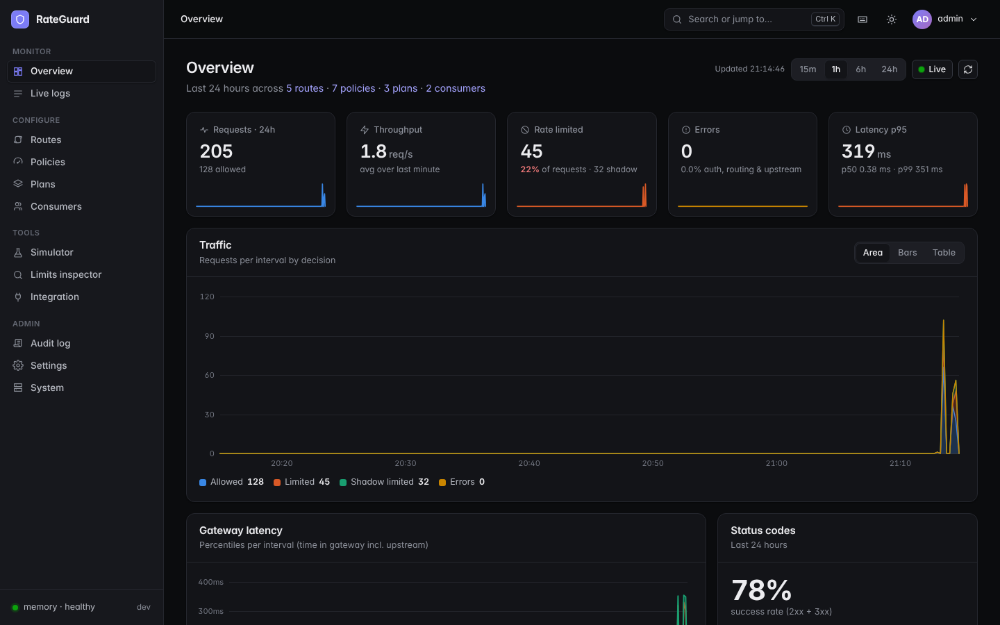

</div>

## Why RateGuard

- **One binary, nothing else to run.** Standard library only: no third-party Go modules, no database, and no frontend build (the dashboard is embedded).
- **Use it the way your stack wants.** Put it in front of your API as a reverse proxy, call a check API from your own code, or plug it into NGINX, Traefik, Caddy, Envoy or ingress-nginx as a forward-auth service.
- **Seven algorithms, chosen per policy.** Token bucket, sliding window, sliding-window counter, fixed window, concurrency, GCRA and leaky bucket (traffic shaping).
- **Roll limits out safely.** Shadow mode logs what a new limit would block without blocking anything. Plans and per-consumer overrides handle tiers.
- **Scales past one process.** The Redis engine runs every algorithm as an atomic Lua script, so several instances share the same counters and the same versioned config.
- **Operable from day one.** A real dashboard (live logs, simulator, limits inspector, audit log), Prometheus metrics, roles, scoped API tokens, and a documented [threat model](docs/SECURITY.md).

## 60-second quickstart

Demo mode seeds routes, one policy per algorithm, plans, two consumers with API keys and a local echo upstream, so you can try everything immediately.

**Docker** (builds the image locally; a published image on `ghcr.io/vishnuptdev/rateguard` ships with the first release):

```bash
docker build -t rateguard .
docker run --rm --name rateguard -p 8080:8080 -p 9000:9000 \
  -e RLG_DEMO=true \
  -e RLG_ADMIN_PASSWORD='choose-a-long-password' \
  -v rateguard-data:/data \
  rateguard
```

**Binary from source** (Go 1.24.7+):

```bash
make build
RLG_DEMO=true RLG_ADMIN_PASSWORD='choose-a-long-password' ./rateguard
```

Then:

1. **Dashboard:** open <http://localhost:9000> and log in as `admin` with the password above. (If you leave `RLG_ADMIN_PASSWORD` unset, a random password is printed once to stderr, or to `docker logs`, and you must change it at first login.)
2. **Demo API keys** are written once to `demo-keys.txt` in the data directory (never logged): `./data/demo-keys.txt` for the binary, `/data/demo-keys.txt` in the container. With Docker, read them with `docker cp rateguard:/data/demo-keys.txt -`.
3. **Send traffic** through the data plane on `:8080` and watch it in **Live Logs**:

```bash
KEY=rlg_live_...   # from demo-keys.txt
curl -i -H "X-API-Key: $KEY" http://localhost:8080/api/orders
# 200, with RateLimit-Limit / RateLimit-Remaining / RateLimit-Reset headers
```

Repeat the request in a loop until you see `429 Too Many Requests` with a `Retry-After` header. Use the **Simulator** page to test a request against your policies without sending it.

Release binaries (linux, macOS, Windows; amd64 and arm64) and SHA-256 checksums will be attached to each [GitHub release](https://github.com/vishnuptdev/rate-limiter-gateway/releases). There is no `go install` path because the Go module is named `ratelimitergateway`.

## Features

- **Reverse proxy:** route by host, path prefix and method; denied requests get `429` with `Retry-After`.
- **Check API:** `POST /_rlg/v1/check` returns an allow/deny decision with a per-operation `cost`.
- **Forward auth:** `/_rlg/v1/auth` for NGINX, Traefik, Caddy, Envoy and ingress-nginx.
- **Policies, plans, consumers:** per-plan and per-consumer overrides; API keys are hashed (SHA-256) and shown once.
- **Shadow mode** and **fail-open / fail-closed** behaviour per policy.
- **Standard headers:** IETF `RateLimit-*` and `RateLimit-Policy`, optional legacy `X-RateLimit-*`.
- **Admin dashboard:** overview charts, streaming logs (filters, CSV export), simulator, limits inspector (peek and reset), integration snippets, audit log, light and dark themes.
- **Access control:** admin, editor and viewer roles, scoped API tokens (`admin`, `read`, `check`), CSRF protection, login lockout.
- **Observability:** Prometheus metrics at `/metrics`; health at `/_rlg/healthz` and readiness at `/_rlg/readyz`.
- **Config you can move:** versioned config store (local JSON file or Redis), import and export.

## Choosing an algorithm

| Algorithm | Behaviour | State per key | Use it when |
|---|---|---|---|
| `token_bucket` | Refills at a steady rate up to a burst capacity | O(1) | You want a steady average rate and can tolerate short bursts |
| `sliding_window` | Exact count of requests in any trailing window | O(requests in window) | You need an exact "N requests per window" contract |
| `sliding_window_counter` | Weighted blend of the current and previous windows (approximate) | O(1) | You want close-to-exact limits at high volume |
| `fixed_window` | One counter per calendar-aligned window | O(1) | You want the simplest option and accept up to 2x burst at a window boundary |
| `concurrency` | Caps in-flight requests; the slot is released when the response completes | O(in-flight) | You need to protect an upstream from simultaneous load (proxy mode only) |
| `gcra` | Generic Cell Rate Algorithm: smooth rate with burst tolerance from one timestamp | O(1) | You want token-bucket behaviour with minimal state and precise `Retry-After` hints |
| `leaky_bucket` | Traffic shaping: requests queue and drain at a fixed rate; the gateway delays them instead of rejecting (max delay 30 s); a full queue gives `429` | O(1) | You must smooth bursts for a fragile upstream and prefer latency over errors |

In Redis mode each algorithm is a single Lua script, which Redis runs atomically, and scripts use the Redis server clock, so instances with skewed clocks still agree.

## Integration modes

| Your situation | Mode |
|---|---|
| You can point clients (or a DNS name) at RateGuard | Reverse proxy |
| You already run NGINX / Traefik / Caddy / Envoy / ingress-nginx and want limits without moving traffic | Forward auth |
| Limits depend on something only your code knows (cost per operation, tenant from the body), or you limit background jobs | Check API |
| You need concurrency limits | Reverse proxy only (the other modes have no completion signal) |

You can also combine them. The full guide, with step-by-step setup, is [docs/INTEGRATION.md](docs/INTEGRATION.md); runnable examples for 12 stacks are in [examples/](examples/).

**1. Reverse proxy.** Point clients at `:8080`; the matched route forwards to its upstream.

```bash
curl -i -H "X-API-Key: rlg_live_..." http://localhost:8080/api/orders
```

**2. Forward auth (NGINX `auth_request`).** RateGuard never proxies; it answers `200` or a denial. Stock NGINX only relays `401`/`403`, so RateGuard is asked for `403` and NGINX maps it to `429` (full file: [examples/nginx/auth_request.conf](examples/nginx/auth_request.conf)).

```nginx
location = /_rateguard_auth {
    internal;
    proxy_pass http://rateguard:8080/_rlg/v1/auth?deny_status=403;
    proxy_pass_request_body off;
    proxy_set_header Content-Length "";
    proxy_set_header X-Forwarded-Method $request_method;
    proxy_set_header X-Forwarded-Uri    $request_uri;
    proxy_set_header X-Forwarded-Host   $host;
    proxy_set_header X-Forwarded-For    $remote_addr;
}
location / {
    auth_request /_rateguard_auth;
    error_page 403 = @ratelimited;   # returns 429 (see the example file)
    proxy_pass http://your-upstream:3000;
}
```

**3. Check API.** Create a token with scope `check` under Settings, API tokens. The response is always `200`; read `allowed`.

```bash
curl -s -X POST http://localhost:8080/_rlg/v1/check \
  -H "Authorization: Bearer $RATEGUARD_TOKEN" \
  -H "Content-Type: application/json" \
  -d '{"method":"GET","path":"/v1/orders","host":"api.acme.com","api_key":"rlg_live_...","cost":1}'
```

## Screenshots

Light on the left, dark on the right.

<table>
  <tr>
    <td>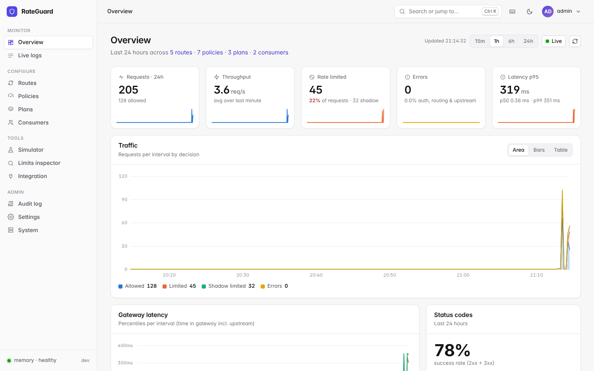</td>
    <td></td>
  </tr>
  <tr>
    <td>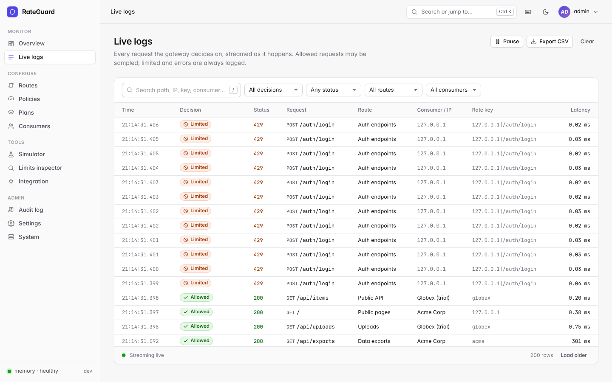</td>
    <td>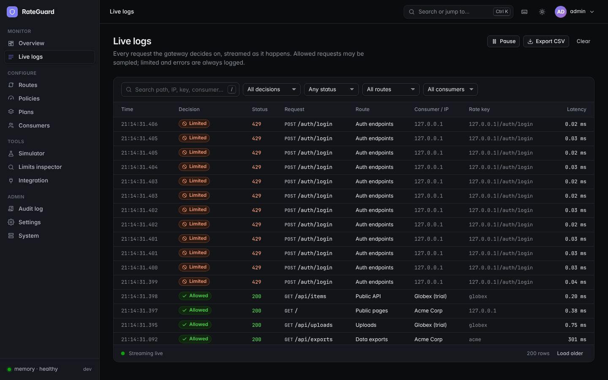</td>
  </tr>
  <tr>
    <td>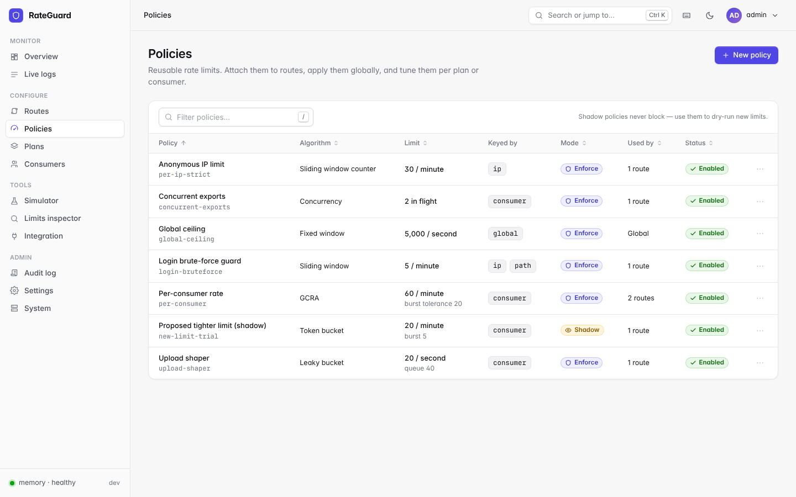</td>
    <td>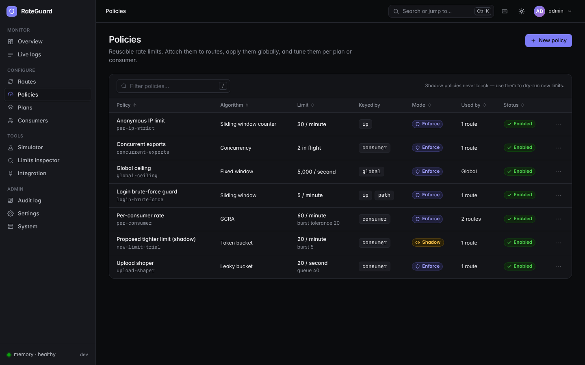</td>
  </tr>
  <tr>
    <td>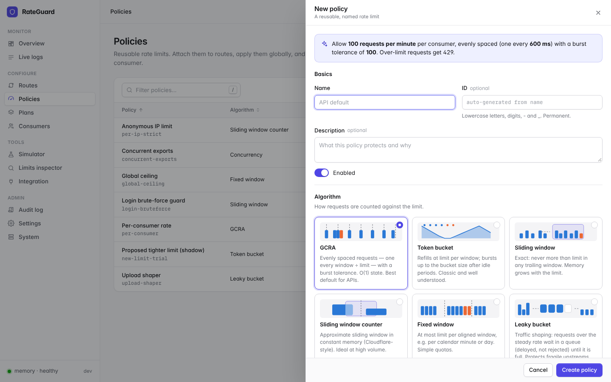</td>
    <td>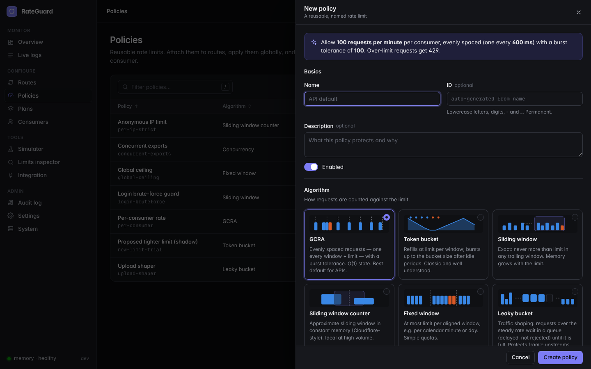</td>
  </tr>
  <tr>
    <td>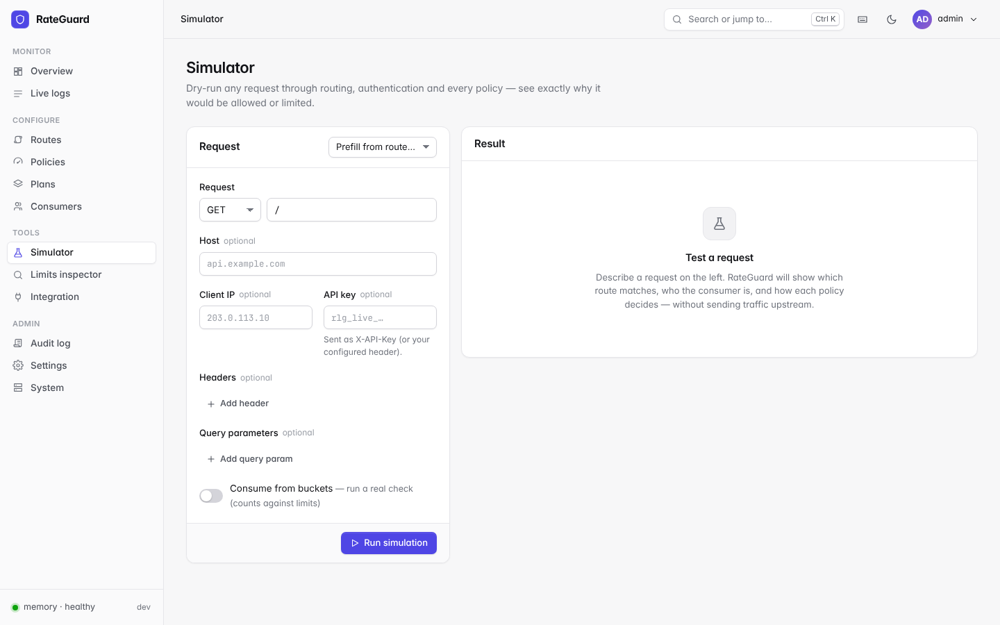</td>
    <td>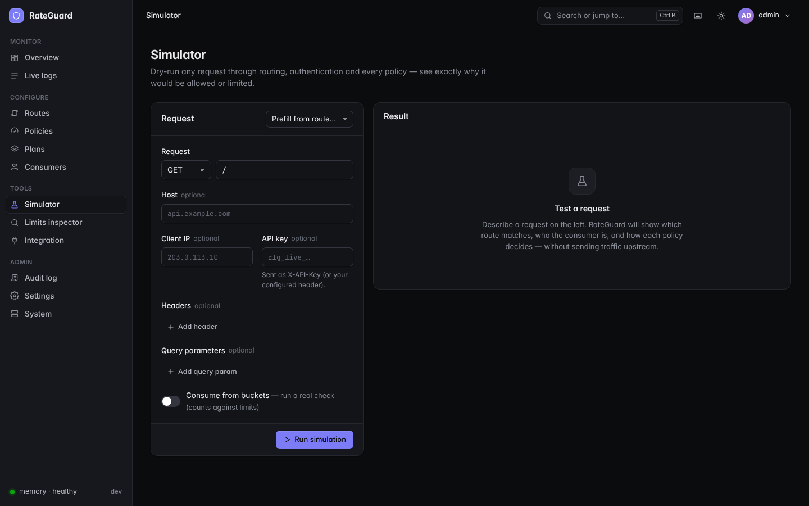</td>
  </tr>
  <tr>
    <td>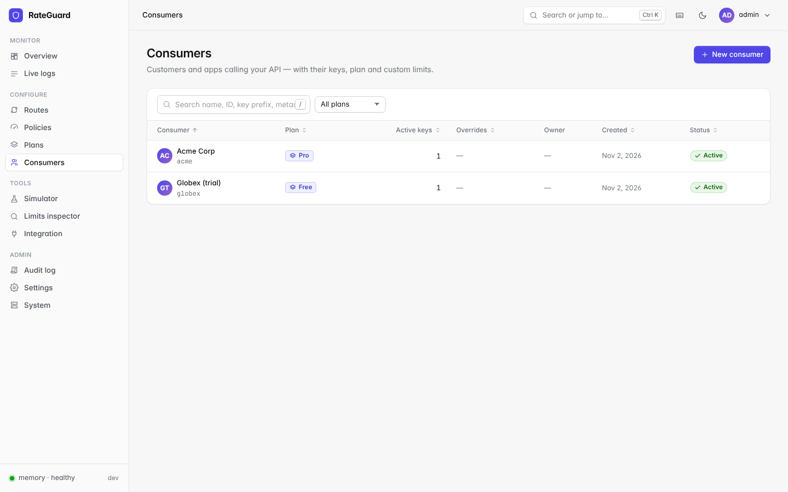</td>
    <td>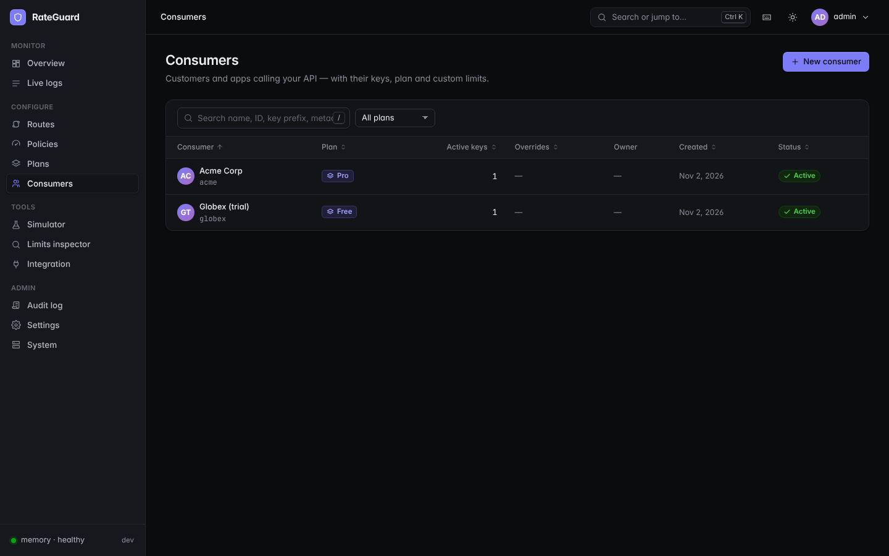</td>
  </tr>
  <tr>
    <td>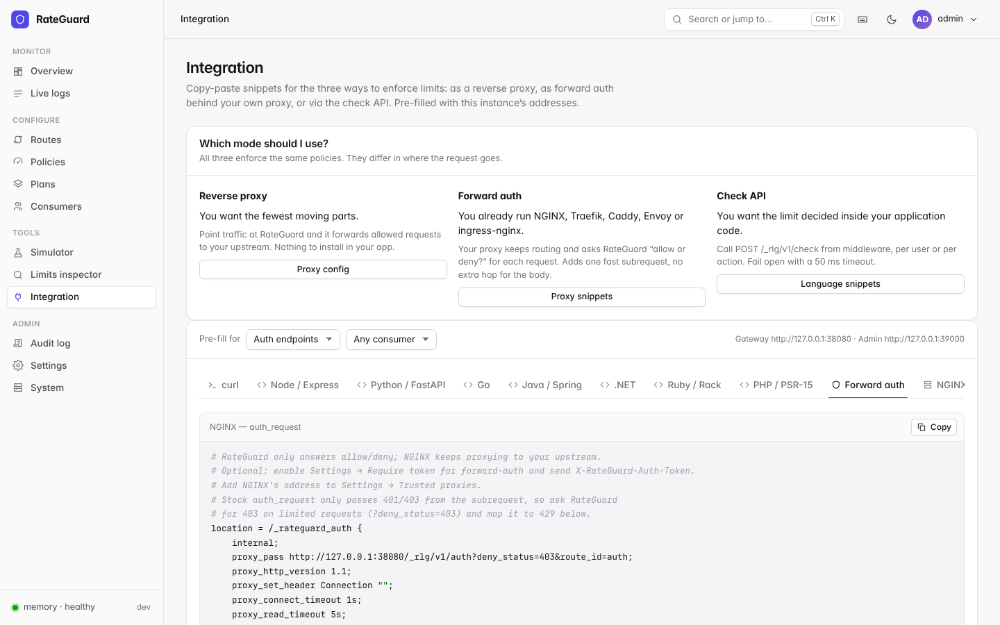</td>
    <td>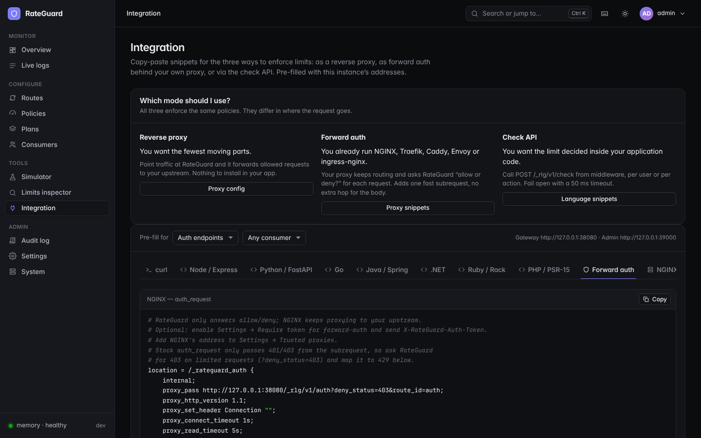</td>
  </tr>
  <tr>
    <td>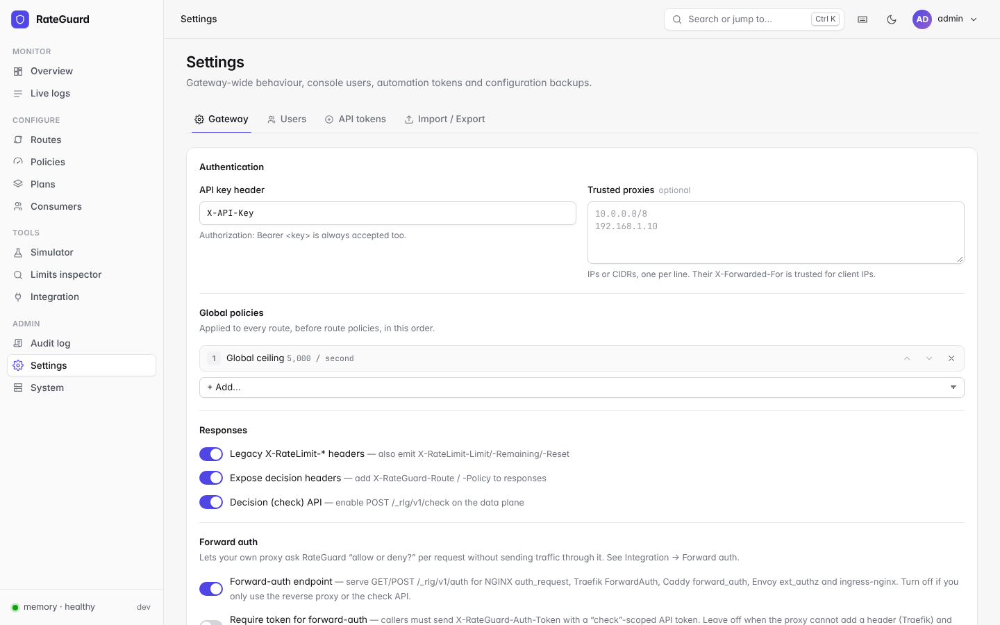</td>
    <td>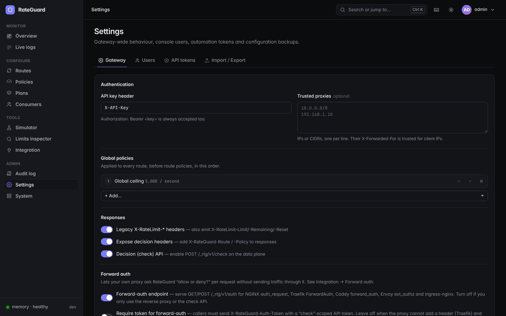</td>
  </tr>
</table>

## Performance

Measured on a 4 vCPU shared Xeon 2.80 GHz microVM (Linux, Go 1.24.7) with the load generator, gateway and upstream all on the same machine. Results on shared VMs moved by 10-15% between runs, so read them as orders of magnitude and measure your own hardware (commands in [docs/PERFORMANCE.md](docs/PERFORMANCE.md#reproducing)).

| What | Result |
|---|---|
| Forward-auth decision over loopback, 1 client, p50 | 137 µs vs 122 µs direct: about **15 µs added** |
| Full proxy path in process (no network), one core | 16-18 µs per request |
| Memory engine `Allow`, 1k hot keys, 4 goroutines | 118-139 ns, 0 allocations (200 ns for concurrency) |
| Proxy over loopback, 8 clients | 18.8k requests/s, p99 2.0 ms |
| Forward auth over loopback, 8 clients | 42.6k requests/s, p99 0.93 ms |

Proxying through any HTTP reverse proxy pays for an extra hop: a proxied request took 342 µs at p50 versus 122 µs direct with one client, and that gap is dominated by the second HTTP round trip, not by RateGuard's decision. The Redis engine adds one Redis round trip per policy (about 45-60 µs against a local Redis here). [docs/PERFORMANCE.md](docs/PERFORMANCE.md) has the full tables, what was optimised, targets that were not met, and a tuning guide.

## Architecture

```
   clients (API keys)                              your services
          │                                              │
          ▼                                              ▼
 ┌────────────────────────────┐              POST /_rlg/v1/check
 │ :8080  data plane          │◀──────────── (Bearer token, scope "check")
 │ route · auth · policies    │
 │ proxy · check · forward    │ ───────────▶ upstream APIs
 │ auth · rate-limit headers  │              (not used in check / forward-auth modes)
 └─────────────┬──────────────┘
               │ atomic counters
               ▼
 ┌────────────────────────────┐
 │ limiter engine             │   RLG_ENGINE=memory | redis
 │ memory, or Redis (Lua)     │◀─ shared by all instances in redis mode
 └────────────────────────────┘

 ┌────────────────────────────┐
 │ :9000  admin plane         │   REST API · sessions/tokens · audit log
 │ dashboard · /metrics       │ ─▶ config store: RLG_STORE=file | redis
 └────────────────────────────┘
```

Config changes made in the dashboard are validated, applied to the running data plane, then saved. With `RLG_STORE=redis`, every instance watches the config version and picks up changes. Details: [docs/ARCHITECTURE.md](docs/ARCHITECTURE.md).

## Configuration

All configuration is through environment variables. Per-route and per-policy settings are managed in the dashboard.

| Variable | Default | Meaning |
|---|---|---|
| `RLG_LISTEN` | `:8080` | Data plane listen address |
| `RLG_ADMIN_LISTEN` | `:9000` | Admin API and dashboard listen address |
| `RLG_DATA_DIR` | `./data` | Local state: `auth.json`, `audit.jsonl`, `config.json` (file store), `demo-keys.txt` (demo) |
| `RLG_ENGINE` | `memory` | Limiter engine: `memory` (per process) or `redis` (shared) |
| `RLG_STORE` | `file` | Config store: `file` (local JSON) or `redis` (shared, versioned) |
| `RLG_REDIS_ADDR` | `127.0.0.1:6379` | Redis address, used when the engine or store is `redis` |
| `RLG_REDIS_PASSWORD` | unset | Redis AUTH password |
| `RLG_REDIS_DB` | `0` | Redis database number |
| `RLG_REDIS_TLS` | `false` | Connect to Redis over TLS |
| `RLG_ADMIN_PASSWORD` | unset | Password for the bootstrap `admin` user (min 12 chars); used only when no users exist yet. If unset, a random one is printed once to stderr |
| `RLG_COOKIE_SECURE` | `false` | Force the `Secure` attribute on session cookies (always set under TLS) |
| `RLG_METRICS_PUBLIC` | `false` | Serve `/metrics` without authentication |
| `RLG_TLS_CERT` | unset | TLS certificate for the admin listener |
| `RLG_TLS_KEY` | unset | TLS key for the admin listener |
| `RLG_ADMIN_TRUST_PROXY` | `false` | Admin plane honours `X-Forwarded-For` / `X-Forwarded-Proto` (set only when behind a trusted proxy) |
| `RLG_DEMO` | `false` | On first start with no config, seed demo data and a local echo upstream on `127.0.0.1:9090` |
| `RLG_LOG_LEVEL` | `info` | `debug`, `info`, `warn` or `error` |
| `RLG_LOG_CAPACITY` | `10000` | Entries kept in the in-memory live-log ring buffer |
| `RLG_MAX_SHAPING_WAITERS` | `10000` | Global cap on requests held waiting by leaky-bucket policies |

Set `RLG_ENGINE=redis` and `RLG_STORE=redis` on every instance that should share limits and configuration, and give each instance its own `RLG_DATA_DIR` (users and API tokens in `auth.json` are per instance; see [docs/SECURITY.md](docs/SECURITY.md#known-limitations)). `rateguard version` prints the build version.

## Response headers

Every rate-limited response carries headers from the most restrictive policy.

| Header | When | Meaning |
|---|---|---|
| `RateLimit-Limit` | Every rate-limited response | Limit of the most restrictive policy |
| `RateLimit-Remaining` | Every rate-limited response | Requests left in the current window |
| `RateLimit-Reset` | Every rate-limited response | Seconds until the window resets |
| `RateLimit-Policy` | Every rate-limited response | `<limit>;w=<window seconds>` |
| `Retry-After` | `429` responses | Seconds to wait, at least 1 |
| `X-RateLimit-Limit`, `-Remaining`, `-Reset` | Legacy headers setting on | Legacy form; `-Reset` is a Unix timestamp |
| `X-RateGuard-Route`, `X-RateGuard-Policy` | `ExposeDecision` setting on | Matched route and deciding policy |
| `X-RateGuard-Consumer` | Upstream requests | Consumer ID; inbound `X-RateGuard-*` headers are stripped so clients cannot spoof them |

```json
{"error":"rate_limited","message":"Rate limit exceeded","policy":"api-per-minute","limit":100,"remaining":0,"retry_after_s":12,"reset_s":12}
```

## Security

Passwords use PBKDF2-SHA256; API keys and tokens are stored only as hashes and shown once; sessions are `HttpOnly` and `SameSite=Strict` with CSRF tokens; the dashboard ships a strict CSP; login attempts are locked out with exponential back-off; every change is audited; in-memory structures are bounded. Known limitations are listed openly (for example, users and tokens are per instance and sessions are in memory). Read [docs/SECURITY.md](docs/SECURITY.md) for the threat model, the hardening checklist and how to report a vulnerability, and do not run production with `RLG_DEMO=true`.

## Deployment

**Docker Compose** runs two RateGuard instances sharing one Redis, plus a demo upstream. Create a `.env` next to the compose file (never commit it):

```bash
REDIS_PASSWORD=<long random string>
RLG_ADMIN_PASSWORD=<at least 12 characters>
```

```bash
docker compose up --build
# instance 1: data :8080, admin :9000    instance 2: data :8081, admin :9001
```

**Kubernetes:** [examples/k8s/rateguard.yaml](examples/k8s/rateguard.yaml) has a Secret, a two-replica Deployment with liveness and readiness probes, and a Service. It needs an existing Redis and uses `emptyDir` for `/data`; read the comments at the top before sending real traffic to it. For ingress-nginx forward auth see [examples/k8s/ingress-nginx-auth.yaml](examples/k8s/ingress-nginx-auth.yaml).

```bash
kubectl apply -f examples/k8s/rateguard.yaml
```

Put TLS in front of the data plane (keys travel in headers) and keep the admin port on a private network.

## FAQ

**Do I need Redis?** No. The default memory engine and file store work for a single instance. Use Redis when you run several instances that must share limits.

**What happens if Redis goes down?** Each policy chooses: `fail_mode: open` lets traffic through, `closed` returns `503 limiter_unavailable`.

**Which algorithm should I start with?** Token bucket for a steady rate with bursts; sliding window if you need a hard "N per window" cap. See the table above.

**Can I test a new limit without breaking users?** Yes. Set the policy to `shadow` mode: it logs would-be denials and lets requests through. Switch to `enforce` once the numbers look right.

**How is the client IP determined behind a load balancer?** `X-Forwarded-For` is trusted only from addresses in Settings, Trusted proxies. Otherwise RateGuard uses the TCP peer, so add your load balancer there or every client will look like one IP.

**Does the check API or forward auth support concurrency limits?** No. Those modes never see the response complete, so concurrency policies are skipped; use the reverse proxy for them.

**Are limits per instance or shared?** With the memory engine each process counts separately. With the Redis engine all instances share counters.

**Is it production-ready?** It has a race-tested suite, a documented threat model and published limitations, but it is a new project (v1.0.0). Review [docs/SECURITY.md](docs/SECURITY.md) and load-test on your own infrastructure first.

## Roadmap

Ideas, not promises:

- Share users and API tokens between instances (today `auth.json` is per instance)
- Persistent sessions so restarts do not log everyone out
- A Helm chart and a published Grafana dashboard for the Prometheus metrics
- Tracking for keys beyond the in-memory key cap, instead of letting overflow keys through untracked

Have a different priority? Open a [feature request](https://github.com/vishnuptdev/rate-limiter-gateway/issues/new?template=feature_request.yml).

## Development

```bash
make build     # build ./rateguard (version from git describe)
make test      # go test -race ./...
make lint      # go vet + gofmt check
make demo      # run with RLG_DEMO=true
make docker    # build the container image
```

Redis tests run when a server is reachable (`REDIS_TEST_ADDR`, default `127.0.0.1:6379`) and skip otherwise.

## Contributing

Contributions are welcome. Read [CONTRIBUTING.md](CONTRIBUTING.md) and the [Code of Conduct](CODE_OF_CONDUCT.md); changes are tracked in [CHANGELOG.md](CHANGELOG.md). Report vulnerabilities privately as described in [docs/SECURITY.md](docs/SECURITY.md).

## License

[MIT](LICENSE) © 2026 vishnuptdev
